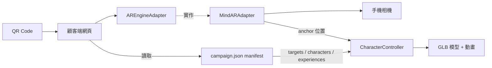

# 架構說明

## 1. 資料夾結構

```
store-ar-platform/
├── frontend/
│   ├── customer/          顧客端（目前可執行）
│   │   ├── public/campaign/   campaign.json、.mind、.glb（POC 靜態活動）
│   │   └── src/
│   │       ├── ar/adapters/   AREngineAdapter（介面）、MindARAdapter（實作）
│   │       ├── ar/renderer/   CharacterController（只認 three.js，不認 MindAR）
│   │       ├── pages/         ArExperience（流程與畫面）
│   │       └── services/      campaignService（讀 manifest）
│   └── admin/             後台（預留）
├── backend/               API、服務、資料庫（預留）
├── shared/types/          前後台共用型別（campaign.ts）
├── assets/                原創測試素材（來源檔）
├── tools/                 素材產生、辨識資料編譯、煙霧測試
└── docs/
```

## 2. 執行時架構



原則（對應規格 §3.3）：
- **前後台分離**：顧客端只讀 manifest，活動內容不寫死在程式。
- **AR 引擎獨立**：UI 與角色邏輯只 import `AREngineAdapter`，換引擎只需新增一個 Adapter。
- **資料驅動**：圖案↔角色↔動畫的對應全在 manifest 的 `experiences`，程式沒有 if/else 配對。
- **版本化發布**：見下節。

## 3. 版本化發布（後台階段實作）

1. 店員上傳圖案 → 後台瀏覽器編譯 `.mind` → 檔名含內容雜湊（例：`targets-3f9a1c.mind`）。
2. 建立新 Campaign Version，產生**不可變** manifest（記錄所有素材網址）。
3. 手機預覽該版本 manifest，通過才按發布。
4. 發布 = 只更新 `campaigns.published_version_id` 指標；舊版檔案保留，回復 = 把指標改回去。
5. 顧客端永遠讀「目前正式版本」的 manifest；素材因檔名含雜湊，不會被快取舊檔。

## 4. 活動狀態轉換（草案，待確認）

| 從 \ 到 | 允許 | 條件 |
|---|---|---|
| DRAFT | PROCESSING | 已選圖案與角色 |
| PROCESSING | READY / FAILED | 辨識資料編譯成功／失敗 |
| FAILED | DRAFT | 修正後重來 |
| READY | PUBLISHED / SCHEDULED / DRAFT | 預覽測試通過才可發布 |
| SCHEDULED | PUBLISHED / READY | 到開始時間自動發布／取消排程 |
| PUBLISHED | EXPIRED / ARCHIVED / READY | 到結束時間／手動下架／回復版本 |
| EXPIRED | ARCHIVED | |
| ARCHIVED | （終點） | 被引用的角色素材不得刪除 |

任何失敗都**不得**影響目前 PUBLISHED 的版本。
